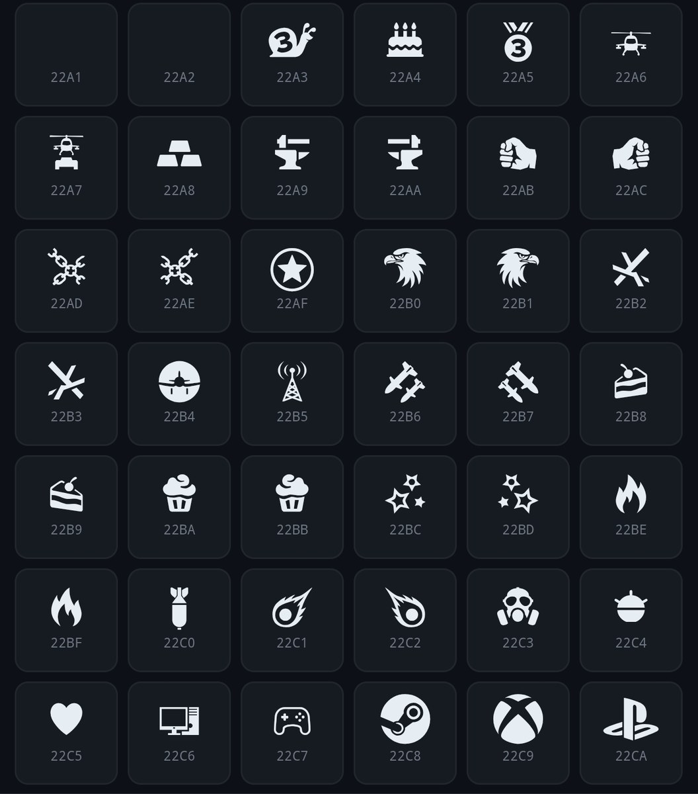

# wtm-fonts

战争雷霆手游（War Thunder Mobile）字体与符号字符研究。

> **符号可用性说明**
>
> 下列符号在 **39 赛季早期版本** 中可正常显示（聊天、昵称等）。
> **后续版本是否仍然可用尚不确定**，如失效请以实际游戏为准。

## 访问地址

| 地址 | 说明 |
|---|---|
| **https://23qwq.eu.cc/** | 主站（Cloudflare 加速 + 人机验证） |
| **https://scpao5.github.io/wtm-fonts/** | GitHub Pages 镜像 |

## 实机效果

下图为游戏内符号字符表（每个图标下标注了对应 Unicode 码位）：

## 这是什么

一个**在线字符表**，用于查找 / 复制游戏内聊天、昵称可用的符号（包括「昵称边框」使用的成对装饰符号）。符号使用与游戏内一致的字体渲染，所见即游戏内效果。

## 在线使用

- **单击**符号 → 复制到剪贴板
- **双击**符号 → 加入底部拼装区
- 顶部输入框 → 按 Unicode 码位搜索（如 `2694`、`25BD`、`22C3`）

## 免责声明

相关字体版权归 **Gaijin Entertainment** 所有，本仓库仅作研究与文字交流参考，请勿用于商业用途，请勿用于破坏游戏公平性的用途。

## 协议

本项目**原创代码**（页面、工具等）采用 **AGPL-3.0**（见 LICENSE）。

附带字体版权归 Gaijin Entertainment，仅作研究参考收录，**不适用本协议**。
